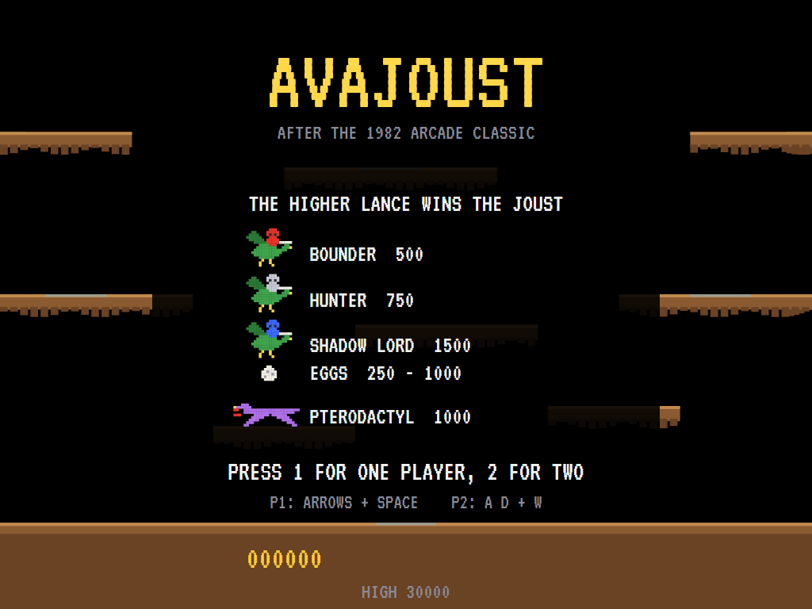
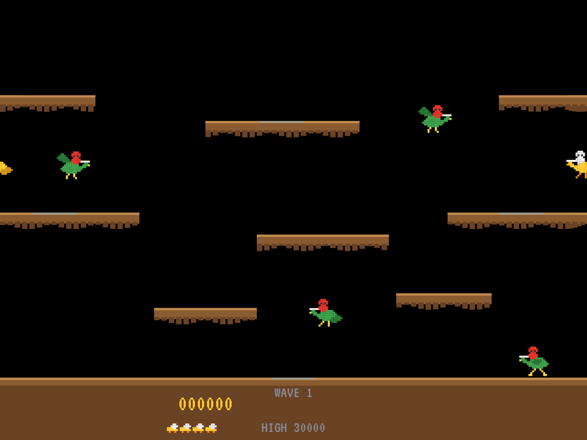
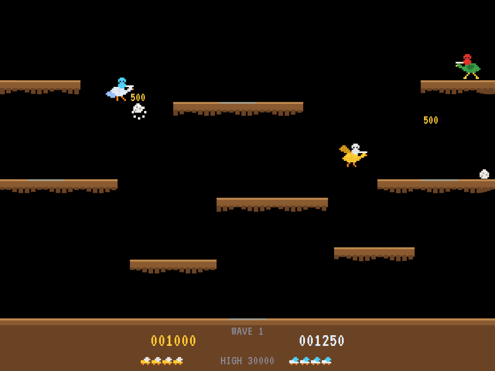
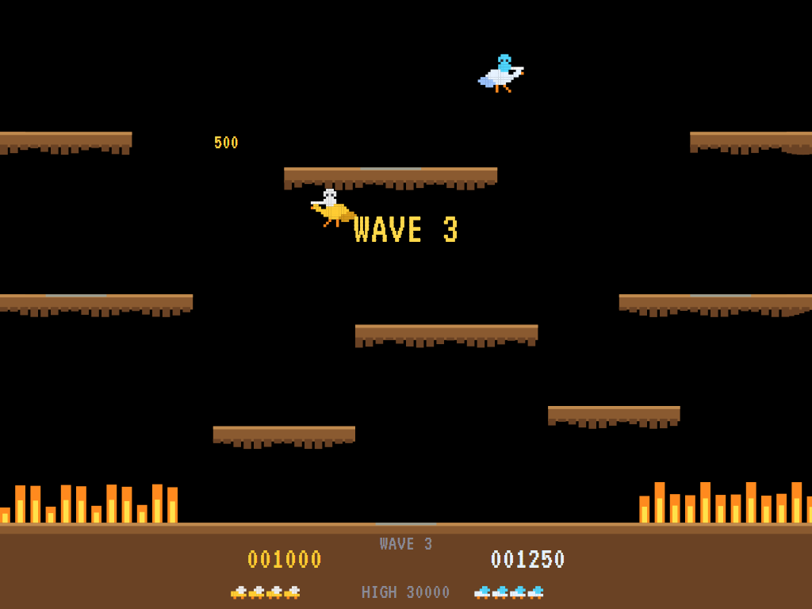
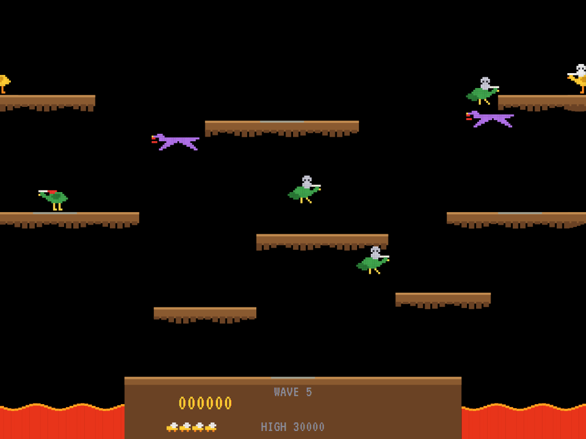
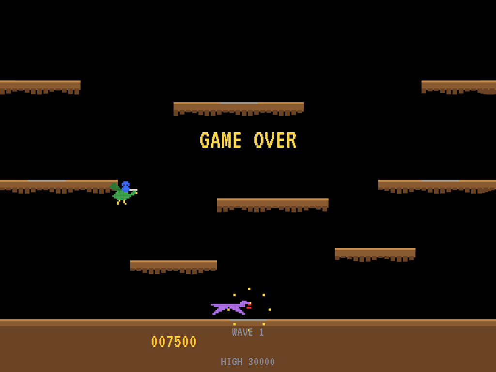
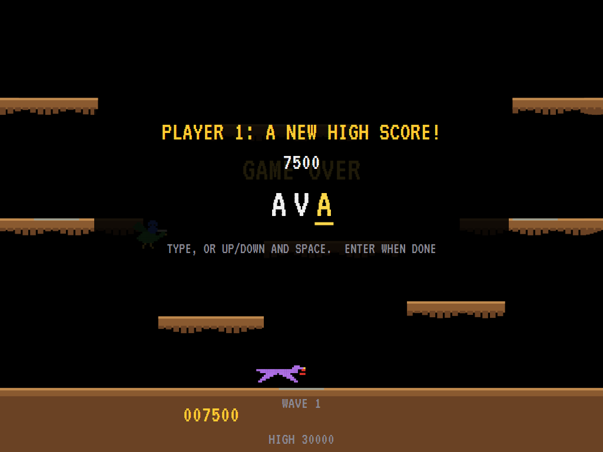
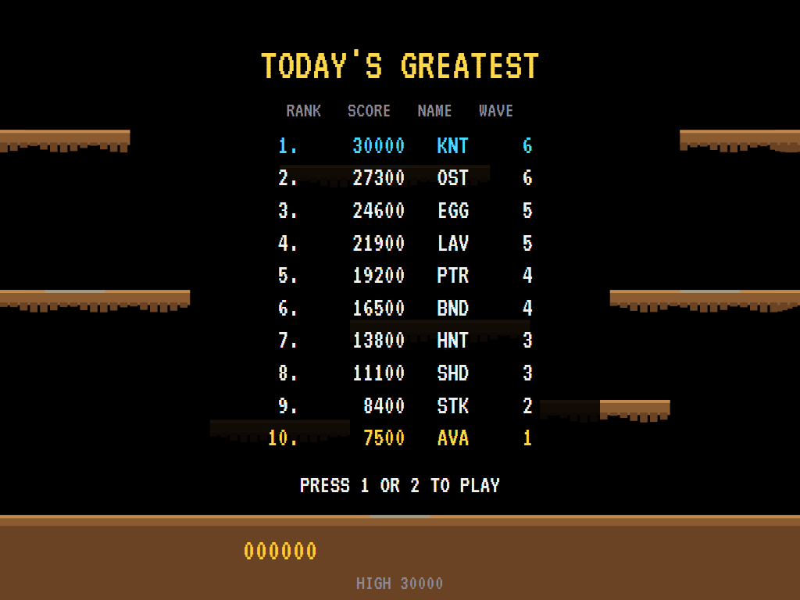

# AVAJoust

[](https://github.com/Harlock123/AVAJoust/actions/workflows/build.yml)

A flap-and-joust arcade game in the style of Williams Electronics' 1982 **Joust**, built with .NET 10 and
Avalonia UI. You're a knight on a flying ostrich. Flap to climb and run along the rock ledges, and meet
the buzzard riders lance to lance: **the higher lance wins**. Beaten riders drop eggs: grab them before
they hatch, or a buzzard swoops down to carry the hatchling back into the fight, tougher than before.
Two players can fly at once, as partners or as rivals.

## Features

- **Flap-and-run physics**: each flap lifts you against gravity; steer in the air, run and skid along
  the ledges, bump your head on their undersides. The screen **wraps** round from side to side.
- **Jousting**: when two riders meet, the higher lance unseats the lower; lances level bounce apart.
- **Three kinds of enemy** on buzzards: **Bounders** (500) wander, **Hunters** (750) come after you,
  **Shadow Lords** (1,500) climb above you and dive. Enemies appear on four glowing spawn pads.
- **Eggs**: an unseated enemy leaves an egg. Collect eggs for **250, 500, 750, then 1,000** each in a
  wave, and **500 more** for one caught in mid-air. Leave one too long and it hatches; a riderless
  buzzard flies in for the hatchling, which comes back one kind tougher.
- **The lava**: on the third wave the bridges at either end of the ground burn away, leaving a lava
  pit. From the fourth wave the **lava troll's hand** reaches up to grab anyone flying too low; flap
  hard to break free.
- **The pterodactyl**: it turns up on its own waves, and on any wave that drags on. It kills at a
  touch, unless your lance meets its **open mouth** head on (1,000).
- **Waves**: more riders and tougher ones as the waves go by, with **survival waves** (3,000 bonus if
  you don't die), **egg waves** (eggs laid on the ledges at the start) and **pterodactyl waves**.
- **Two players at once**, each with their own score and riders. Unseat your partner for the
  **gladiator's prize** of 3,000.
- **Five riders** each, and another every 20,000 points.
- **Attract mode**: leave the title alone for 15 seconds and a computer knight plays a demonstration,
  with all its sounds.
- **Top-ten high-score table** with arcade-style initials entry, for each player in turn.
- **Synthesised sound**, mixed by OpenAL: wing beats, skids, the clang of level lances, eggs, the
  pterodactyl's screech, the lava's sizzle, a galloping title tune, and short original tunes for each
  wave and the game over.
- **Keyboard or gamepads** (one each). **Any window size**: the screen scales to fit, letterboxed.
  **Ctrl+S** saves a screenshot.
- **One self-contained executable** per platform: Windows, macOS and Linux on Intel/AMD and ARM.

All the sprites, sounds and tunes are this game's own.

## Screenshots

| Title screen | The first wave | Two players |
|:------------:|:--------------:|:-----------:|
|  |  |  |
| The riders, what they're worth, and how to start. | The ostrich knight against the first Bounders. | Ostrich and stork: two knights, eggs, and points. |

| The bridges burn | The lava and the pterodactyl | Game over |
|:----------------:|:----------------------------:|:---------:|
|  |  |  |
| Wave 3: the bridges catch fire. | The lava pit, and two pterodactyls hunting. | The last rider lost. |

| Entering initials | The high-score table |
|:-----------------:|:--------------------:|
|  |  |
| A top-ten score earns three initials. | The new entry flashes in the table. |

The screenshots are made by the tests, which play the game in a real (headless) window; see
[Tests](#tests).

## Download and run

Ready-to-run builds for Windows, macOS and Linux, on both Intel/AMD and ARM, are on the
[Releases page](https://github.com/Harlock123/AVAJoust/releases/tag/latest). **Latest build** is rebuilt
on every push to `main`. Each download is one self-contained executable: no .NET install is needed.

| Platform | Archive |
|---|---|
| Windows | `AVAJoust-win-x64.zip`, `AVAJoust-win-x86.zip`, `AVAJoust-win-arm64.zip` |
| macOS | `AVAJoust-osx-arm64.tar.gz` (Apple silicon), `AVAJoust-osx-x64.tar.gz` (Intel) |
| Linux | `AVAJoust-linux-x64.tar.gz`, `AVAJoust-linux-arm64.tar.gz`, `AVAJoust-linux-arm.tar.gz` |

```bash
tar -xzf AVAJoust-linux-x64.tar.gz     # or linux-arm64, linux-arm, osx-arm64, osx-x64
./AVAJoust
```

On Windows, unzip and run `AVAJoust.exe`. On macOS, if Gatekeeper refuses to open it, run
`xattr -d com.apple.quarantine AVAJoust` once. Run with `--no-audio` for silence.

**Sound** comes through OpenAL Soft, built in for every platform. In a virtual machine the game
detects it and uses a larger audio buffer, so the sound doesn't break up.

**Gamepads** use SDL2, which is bundled for Windows, macOS and Intel/AMD Linux. ARM Linux builds need it
installed; without it the keyboard still works:

```bash
sudo apt install libsdl2-dev            # Debian / Ubuntu / Raspberry Pi OS
sudo pacman -S --needed sdl2-compat     # Arch / Omarchy
```

## Controls

| | Player 1 (ostrich) | Player 2 (stork) |
|---|---|---|
| Move | **Left** / **Right** | **A** / **D** |
| Flap | **Space**, **Up** or **Right Ctrl** | **W**, **Left Shift** or **Left Ctrl** |
| Gamepad | the first: D-pad or stick, **A** to flap | the second, the same |

Tap to flap; hold to flap steadily. In a one-player game either set of keys flies player 1.

| Key | Action |
|-----|--------|
| **1** / **Enter** | Start a one-player game |
| **2** | Start a two-player game |
| **P** / **Esc** | Pause (Esc again to quit); **Start** on a gamepad |
| **M** | Mute |
| **Ctrl+S** / **Cmd+S** | Save a screenshot to the Pictures folder |

**Entering initials**: type letters, or dial with **Up**/**Down** and accept with **Space**; **Left** /
**Backspace** go back; **Enter** finishes. Gamepad: the D-pad dials and moves, **A** accepts, **Start**
finishes.

## Scoring

| | Points |
|---|---:|
| Bounder (red knight) | 500 |
| Hunter (grey knight) | 750 |
| Shadow Lord (blue knight) | 1,500 |
| Eggs in a wave | 250, 500, 750, then 1,000 each |
| An egg caught in mid-air | 500 more |
| Pterodactyl | 1,000 |
| Unseating the other player | 3,000 |
| Surviving a survival wave | 3,000 |

## Tests

```bash
dotnet test AVAJoust.slnx
```

The engine has no UI and runs in fixed 60 Hz steps, so it plays the same at any frame rate, and a seed
always plays the same game. The tests check the physics (flapping, landing, the wrap, the ledges that
reach round it), jousts won, lost and bounced, the egg scores, hatching into a tougher rider, the
bridges and the lava, the wave pattern, the pterodactyl's one weak spot, two players unseating each
other, the bonus riders, the title and demonstration cycle, the high-score table, every sound and every
sprite. A computer knight (the attract-mode one) plays whole games in them.

The screenshot tests draw the real screen in a headless window. To refresh the README's pictures:

```bash
JOUST_SHOTS=$PWD/Images dotnet test tests/AVAJoust.Tests --filter ScreenshotTests
```

## Building

```bash
dotnet build AVAJoust.slnx
dotnet run --project src/AVAJoust
```

Needs the .NET 10 SDK. The sounds are made by `tools/make_sounds.py` (standard-library Python):
`python3 tools/make_sounds.py` rewrites `src/AVAJoust/Sounds`.

## Project structure

```
AVAJoust/
├── AVAJoust.slnx
├── src/AVAJoust/
│   ├── Engine/
│   │   ├── GameEngine.cs          # States, players, scores, bonus riders, initials for each player
│   │   ├── GameEngine.Physics.cs  # Flapping, running, skidding, ledges, the wrap, the lava and the troll
│   │   ├── GameEngine.Waves.cs    # Waves, spawning, enemy brains, jousts, eggs, hatchlings, the pterodactyl
│   │   ├── Entities.cs            # Riders, eggs, buzzards, the pterodactyl
│   │   ├── AttractPilot.cs        # The computer knight for the demonstration (and the tests)
│   │   ├── HighScoreTable.cs, InitialsEntry.cs
│   │   ├── InputHandler.cs, ControllerManager.cs  # Two players' keys and SDL2 gamepads
│   │   └── SoundManager.cs        # Effects and tunes through OpenAL
│   ├── Audio/                     # The OpenAL engine (from the author's AVABand)
│   ├── Models/                    # The arena's ledges and pads, and the pixel-art sprites
│   ├── Views/                     # The screen: the arena, the riders, the scores, title and tables
│   └── Sounds/                    # The synthesised effects and tunes
├── tests/AVAJoust.Tests/          # Gameplay and screenshot tests
├── tools/make_sounds.py
└── Images/                        # Screenshots
```

## About and licence

AVAJoust © 2026 Lonnie Watson, under the [MIT License](LICENSE).

*Joust* © 1982 Williams Electronics; the name belongs to its current owner. AVAJoust is an independent,
unofficial game in its style. Its sprites, sounds, tunes and code are its own; nothing is taken from the
arcade machine's program, graphics or sound. It is not affiliated with or endorsed by any rights holder.

Bundled components keep their own licences: the VT323 font (SIL Open Font License 1.1, by Peter Hull;
`src/AVAJoust/Assets/Fonts/VT323-OFL.txt`), OpenAL Soft (LGPL-2.0-or-later; loaded as a separate
library; `src/AVAJoust/Audio/native/COPYING-openal-soft.txt`), and the MIT-licensed Avalonia, Silk.NET,
NVorbis, NLayer and SDL2-CS (with SDL2 under the zlib licence).
